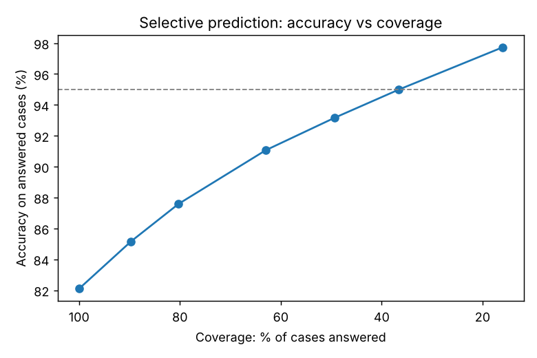
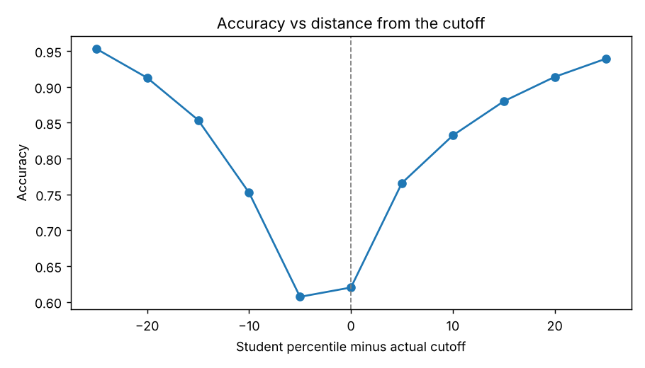

# MHT-CET College Predictor (ML)

Predicts the cutoff percentile for each Maharashtra engineering **college / branch / category**
from CAP rounds 1-4 data, and turns it into a calibrated **probability of admission** for a student's
percentile. Built for the *Mission Admission A2Z* project.

## Headline results (held-out test, leak-free)

All numbers below are produced by `python -m src.train --robustness` and saved in [`metrics.json`](metrics.json).

| What | Result |
|---|---|
| Cutoff regression, random 80/20 split | MAE **10.77** percentile points, R² 0.685 |
| 5-fold CV MAE | 10.66 ± 0.12 |
| Temporal split (train rounds 1-3 → predict round 4) | MAE 10.07, admission accuracy 82.7% |
| Unseen colleges (GroupKFold by college) | MAE 21.2, R² 0.12 (weak; see limits) |
| Admission yes/no accuracy, all students | **82.1%** (84.1% excluding the exact-tie case), ROC-AUC 0.894 |
| Accuracy when the student is ≥10 points from the cutoff | 88.0% |
| Selective prediction: answer only when ≥90% confident | **95.0% accuracy on 36.7% of cases** |
| Selective prediction: ≥95% confident | 97.7% accuracy on 16.1% of cases |

**This is not a 95%-accurate model overall, and we do not claim that.** Overall accuracy is 82%.
95%+ is reached only on the subset of cases where the model is confident, and coverage is always reported with it.
See [docs/MODEL_CARD.md](docs/MODEL_CARD.md) for why, including an evaluation leak that was found and removed.

| Selective prediction | Accuracy by distance from cutoff |
|---|---|
|  |  |

## How it works

1. **Point model**: RandomForest + 4 HistGradientBoosting variants, blended with NNLS stacking.
2. **Uncertainty model**: a boosted regressor predicts the ensemble's own absolute error per row (sigma).
3. **Calibration**: `z = (student − predicted cutoff) / sigma` is mapped to a probability with isotonic regression
   fitted on a held-out calibration slice, so "90% likely" means about 90%.

Features: college, branch, category, gender scope, allocation level (home/other university/state), seat source,
region, CAP round. `sml_rank` is **deliberately excluded** (correlation −0.98 with the target = leakage).

## Quickstart

```bash
pip install -r requirements-dev.txt
python -m src.train                  # ~2 min: fit, leak-free evaluation, figures, models/bundle.joblib
python -m src.train --robustness     # + 5-fold CV, unseen colleges, temporal split (~15 min)
pytest -q
```

```python
import joblib
bundle = joblib.load("models/bundle.joblib")   # run from the repo root so the src.* classes resolve
bundle.recommend(percentile=92.0, category="GOPENS", branch="Computer Engineering", top_n=10)
bundle.recommend(percentile=88.5, gender="Female", region="Pune", min_probability=0.4)
```

Results are sorted by admission probability, so the safest colleges come first.

## Google Colab

[`notebooks/MHT_CET_College_Predictor_Colab.ipynb`](notebooks/MHT_CET_College_Predictor_Colab.ipynb) runs the same
method end to end (upload `data/combined_cutoffs.csv` when prompted).

## Layout

```
mht-cet-college-predictor/
  data/combined_cutoffs.csv   CAP cutoffs, rounds 1-4 (49,180 rows, 366 colleges)
  src/features.py             region / gender / allocation feature helpers
  src/model.py                encoders, ensemble, sigma model, calibration, ModelBundle.recommend()
  src/train.py                training + leak-free evaluation CLI (writes metrics.json, figures, model)
  experiments/                scripts behind the claims in the model card (leak demo, noise floor)
  notebooks/                  Colab notebook
  tests/                      pytest suite (also run by CI)
  docs/MODEL_CARD.md          method, results, limits
```

## Limits

- Four CAP rounds of data only. Cutoffs move a median 5.4 and mean 11.3 percentile points between rounds for the
  same college/branch/category, so there is a hard noise floor; more years of data is the real lever.
- Poor on colleges never seen in training (R² 0.12); it ranks colleges already in the data.
- Probabilities are for ranking and guidance, not a guarantee of admission.
